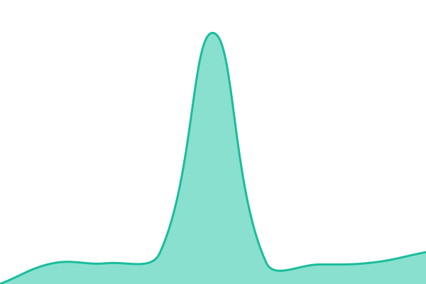

# [📈 Live Status](https://uptime.showdigital.in): <!--live status--> **🟧 Partial outage**

This repository contains the open-source uptime monitor and status page for [Vistaar Digital](https://www.vistaardigital.com), powered by [Upptime](https://github.com/upptime/upptime).

With [Upptime](https://upptime.js.org), you can get your own unlimited and free uptime monitor and status page, powered entirely by a GitHub repository. We use [Issues](https://github.com/vistaardigital/uptime/issues) as incident reports, [Actions](https://github.com/vistaardigital/uptime/actions) as uptime monitors, and [Pages](https://uptime.showdigital.in) for the status page.

<!--start: status pages-->
<!-- This summary is generated by Upptime (https://github.com/upptime/upptime) -->
<!-- Do not edit this manually, your changes will be overwritten -->
<!-- prettier-ignore -->
| URL | Status | History | Response Time | Uptime |
| --- | ------ | ------- | ------------- | ------ |
|  [Enablr Sales Dev](https://dev.enablrsales.com/) | 🟥 Down | [enablr-sales-dev.yml](https://github.com/vistaardigital/uptime/commits/HEAD/history/enablr-sales-dev.yml) | 

 2194ms
     
 | 

<a href="https://uptime.showdigital.in/history/enablr-sales-dev">25.95%</a>
    

|  [Vistaar Digital](https://www.vistaardigital.com) | 🟩 Up | [vistaar-digital.yml](https://github.com/vistaardigital/uptime/commits/HEAD/history/vistaar-digital.yml) | 

 3549ms
     
 | 

<a href="https://uptime.showdigital.in/history/vistaar-digital">100.00%</a>
    

|  [Enablr Sales](https://enablrsales.com/) | 🟩 Up | [enablr-sales.yml](https://github.com/vistaardigital/uptime/commits/HEAD/history/enablr-sales.yml) | 

 3079ms
     
 | 

<a href="https://uptime.showdigital.in/history/enablr-sales">100.00%</a>
    

|  [Enablr Sales Admin](https://app.enablrsales.com/) | 🟩 Up | [enablr-sales-admin.yml](https://github.com/vistaardigital/uptime/commits/HEAD/history/enablr-sales-admin.yml) | 

 2175ms
     
 | 

<a href="https://uptime.showdigital.in/history/enablr-sales-admin">100.00%</a>
    

|  [Activatr](https://activatr.in/) | 🟩 Up | [activatr.yml](https://github.com/vistaardigital/uptime/commits/HEAD/history/activatr.yml) | 

 2227ms
     
 | 

<a href="https://uptime.showdigital.in/history/activatr">100.00%</a>
    

|  [Pharma Sales](https://salesdashboard.enablrsales.com/) | 🟩 Up | [pharma-sales.yml](https://github.com/vistaardigital/uptime/commits/HEAD/history/pharma-sales.yml) | 

 1844ms
     
 | 

<a href="https://uptime.showdigital.in/history/pharma-sales">100.00%</a>
    

<!--end: status pages-->

[**Visit our status website →**](https://uptime.showdigital.in)

## 📄 License

- Powered by: [Upptime](https://github.com/upptime/upptime)
- Code: [MIT](./LICENSE) © [Anand Chowdhary](https://anandchowdhary.com)
- Data in the `./history` directory: [Open Database License](https://opendatacommons.org/licenses/odbl/1-0/)
